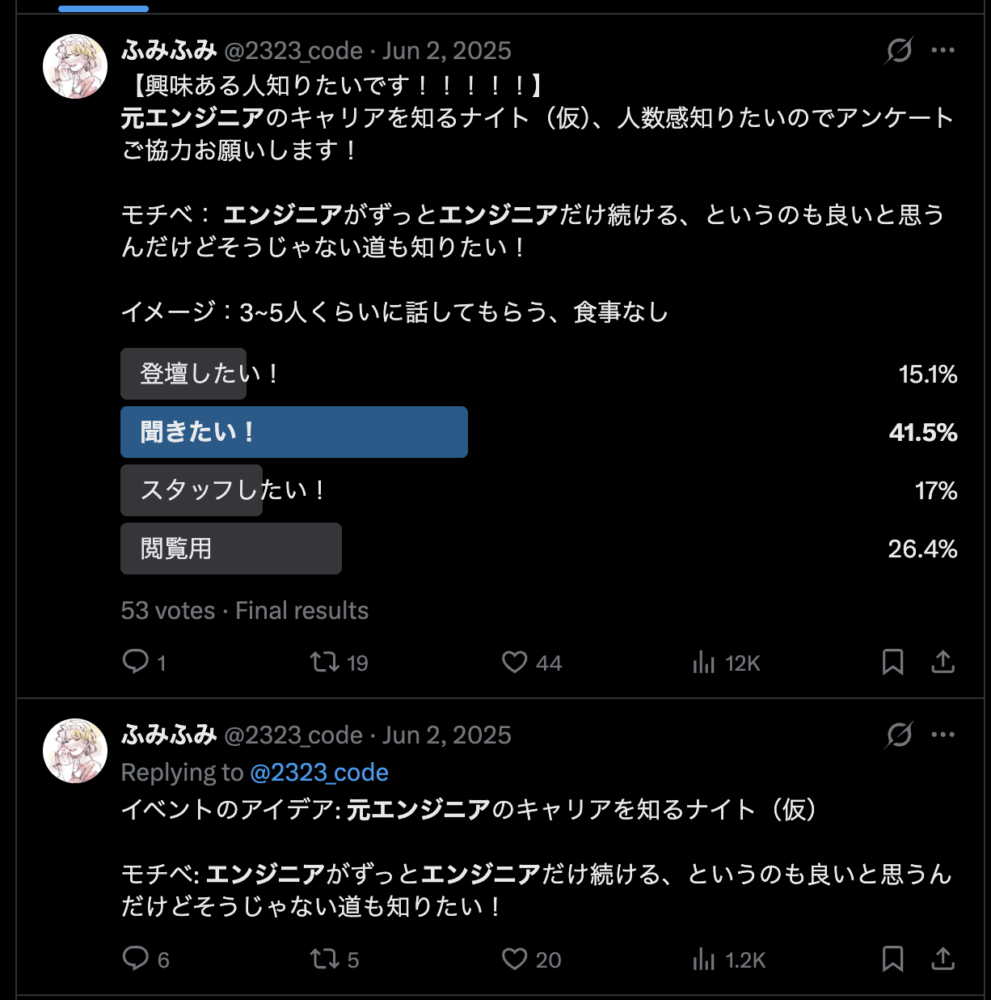
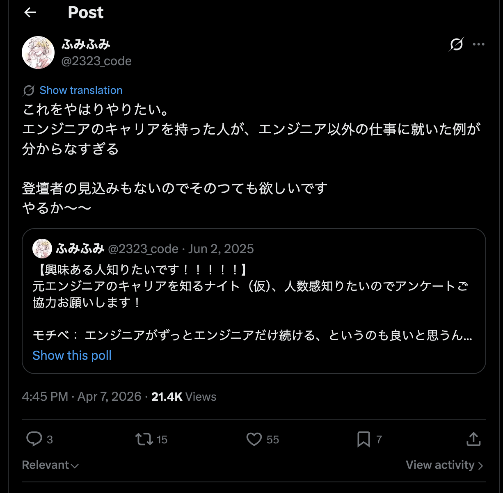
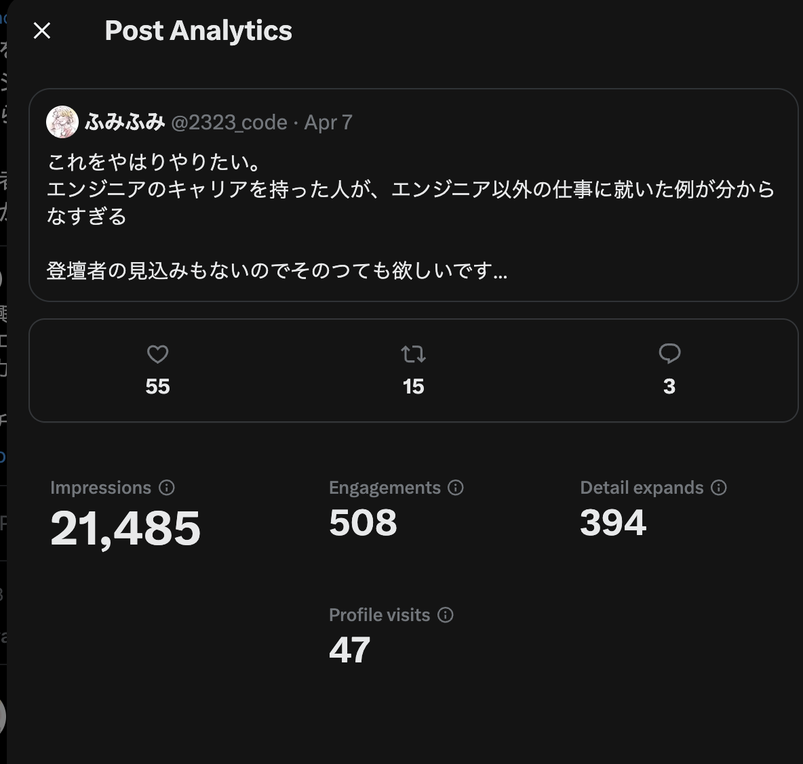

# 聞きたい話はツイートしよう

## 2026/05/15 @ kitaku.dev

## ふみふみ

---

## きたく.dev、第二回目おめでとうございます 🎉

みんなでツイートしよう 💃

---

QRコードを読み取ると、きたく.devのハッシュタグ付きでツイートできます！

---

ツイートできたところで...

---

## 今日一番話したいこと

✅ 聞きたい話がある場合はツイートしてみるといい
✅ イベントにせずともツイートするだけでも話を聞くきっかけはできる

---

## まとめ

- 聞きたい話がある場合はツイートしてみるといい
- 発信する人間に情報は集まる
- あなたが気になっている話は、他の人も気になっているかもしれない

---

## 自己紹介

### ふみふみ

- 元Webエンジニア、現在無職

- 単発、継続イベントなどを企画・運営していました

- 趣味は可愛い服を着ること

---

## おしながき

- なぜツイートするのか

- ツイートした結果どうなったか

- まとめ

---

## なぜツイートするのか

- 発信されていれば、知っている人間がいる可能性があるから
- 自分の意図しない範囲のツテに情報が届く可能性があるから
- イベント運営が大変な場合、イベントにせずともツイートするだけでも話を聞くきっかけが作れるから

---

## 例えば：

エンジニアって、スペシャリストかマネジメント職以外のキャリアパスないんかな...
調べてみてもあまりヒットしない...

---

## ツイートしてみた

---

---

---

なんかすごい引用されてる...

---

## とはいえ。注目を集めやすい内容だったのもあると思う

- AIが出てきて、エンジニアの仕事がなくなるのではないかと不安に思う人は多い
- 共感を得やすい内容だったのもあると思う

---

## その後

- 想像以上に「こんな人いるよ」と情報が集まった

---

## 結果

### 6/11にイベントやります！！！

---

## まとめ

- 聞きたい話がある場合はツイートしてみるといい
- 発信する人間に情報は集まる
- あなたが気になっている話は、他の人も気になっているかもしれない

---

よきイベントライフを🌱

ご清聴ありがとうございました。
